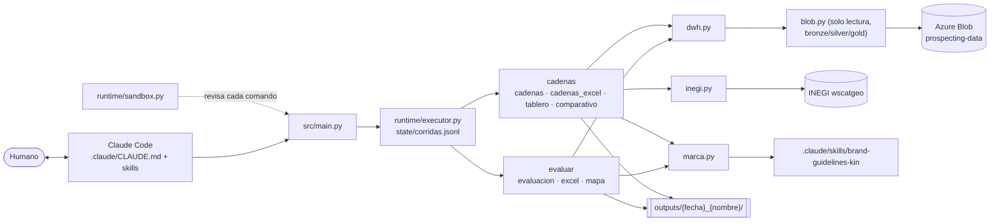

# SPEC · davinci

> Especificación del agente de analítica sobre el datawarehouse de Customer Potential (estado del 2026-10-30).
> Audiencia: agentes de IA y equipos que mantengan o extiendan el sistema. Citas `ruta/archivo.py` (función).
> Lo que no se deduce del dato o del código: `⚠️ SUPUESTO` o `❓ PREGUNTA ABIERTA`.

## 1. Resumen

davinci es un **arnés agéntico sobre Claude Code**: Claude Code es el cerebro y el bucle; `.claude/CLAUDE.md` y las
skills son el prompt; `src/` son las herramientas, que se corren por una entrada única
(`uv run python -m src.main <comando>`). Lee el datawarehouse de Customer Potential en Azure Blob (`prospecting-data`)
**en solo lectura y de bronze para arriba**, y entrega a un tomador de decisiones **Excel, mapas y tableros HTML** con
la marca Kin. No sube nada al blob.

## 2. Alcance

| Incluye | Evidencia |
|---|---|
| `evaluar`: clientes que compran, segmentos, potencial del modelo → Excel + mapa | `src/tools/evaluacion.py`, `excel.py`, `mapa.py` |
| `cadenas`: retail por cadena con limpieza de franquicia → UN Excel con fórmulas + tablero | `src/tools/cadenas.py`, `cadenas_excel.py`, `tablero.py` |
| `cadenas --territorios`: comparación de territorios juntos/separados con mapa interactivo | `src/tools/comparativo.py` |
| Arnés: entrada única, bitácora, hook de seguridad del blob | `src/main.py`, `src/runtime/*.py`, `.claude/settings.json` |

**Fuera de alcance:** escribir en el blob; el modelo Customer Potential y los procesos de Synapse; los flujos que
producen bronze/silver/gold (los consume, no los genera).

## 3. Glosario

| Término | Significado |
|---|---|
| Capas | `bronze`, `silver`, `gold` del datawarehouse (`settings.CAPAS`); `drop_zone` (crudo) no se usa |
| Análisis | categoría custom del catálogo (p. ej. `hydration`) |
| Cadena / franquicia | cadena de retail inferida por nombre (OXXO, Walmart…); con `--otras`, las no foco van a "Otras cadenas" y la franquicia queda en su columna |
| Independientes | clientes validados del canal moderno que no son de una cadena |
| Territorio | `Nombre=embotellador:Estado INEGI[/Municipio INEGI]` |
| Periodo comparable | últimos 12 meses completos vs los mismos meses del año anterior |
| Estatus | Activo · Nuevo (1.ª compra en 6 meses) · Perdido (3+ meses sin compra) · Nunca compró |
| POR VERIFICAR | lo que el dato no trae; no se estima |

## 4. Requisitos funcionales

**RF-01 · Entrada única.** `python -m src.main <comando> [flags]` con `evaluar` o `cadenas`; comando desconocido →
ayuda y código 2. *Test:* `Entrada.test_comando_desconocido`.

**RF-02 · Bitácora.** Cada corrida se anota en `state/corridas.jsonl` (comando, argv, código, error, segundos), también
si falla (`runtime/executor.py`).

**RF-03 · Guardia del blob.** Hook PreToolUse: todo comando Bash/PowerShell que suba, copie o borre en el blob
responde `permissionDecision: "ask"`; el resto pasa (`runtime/sandbox.py`). *Tests:* `Sandbox.*`.

**RF-04 · Solo bronze para arriba.** `blob.ultima_corrida` rechaza rutas fuera de `settings.CAPAS` (SystemExit).
*Test:* `Entrada.test_solo_bronze_para_arriba`.

**RF-05 · Última corrida, solo lo que se usa.** De cada ruta se toma la carpeta de fecha más reciente y se baja solo
el archivo principal a `data/` (espejo local); no se vuelve a bajar si está con el mismo tamaño (`blob`, `dwh.bajar`).

**RF-06 · Periodo comparable.** Si el último mes trae < 70% de la mediana de los 12 anteriores es corte del extracto y
queda fuera; se comparan los últimos 12 meses completos con los mismos meses del año anterior (`dwh.ventas`).

**RF-07 · evaluar.** Por embotellador: silver de clientes que compran + ventas de bronze + gold (si existe). Segmentos,
resumen, por estado/municipio/subcanal, prioridad del modelo, listas "recuperar" y "crecer", hallazgos.
Sin gold → potencial POR VERIFICAR. QA: un cliente por fila; suma por estado = total. Salida
`outputs/{AAAAMMDD}_cp_{analisis}_{pais}/`.

**RF-08 · Franquicia por nombre limpio.** `cadenas.clasificar`: regex → alias sobre el nombre limpio (sin acentos ni
signos, letras sueltas unidas) en palabras que empiezan con el alias → aproximado (similitud ≥ 0.88, alerta
"verificar"); exclusiones por cadena. Devuelve cadena, formato, tipo de punto, nombre limpio y método.
*Test:* `Cadenas.test_limpieza_infiere_la_franquicia`.

**RF-09 · Geografía INEGI.** Estado, municipio, CVEGEO y población por polígono municipal (servicio wscatgeo de INEGI,
en caché); fuera de todo polígono → municipio más cercano con la distancia (`inegi.asignar`).

**RF-10 · cadenas → UN Excel.** Un solo archivo con todos los embotelladores/territorios, el pitch del Excel de
referencia y fórmulas vivas sobre 'Detalle PdV': Resumen · [Comparativo · Por territorio] · Detalle PdV · Por zona ·
Por estado · Por municipio · Tendencia mensual · Productos (`cadenas_excel.escribir`).

**RF-11 · Territorios.** `--territorios` filtra cada embotellador a su territorio y agrega la columna Territorio; la hoja
Comparativo repite los indicadores del Resumen para Juntos y cada territorio (+ índice entre dos territorios).
*Test:* `Cadenas.test_territorios`.

**RF-12 · Tableros.** Nacional (`tablero.py`) y de territorios (`comparativo.py`). El de territorios:
- Resumen: frases-dato, KPIs, cara a cara, mezcla del revenue por grupo y comparaciones **en pares** (misma cadena o
  franquicia, una barra por ciudad) de crecimiento, consumo por tienda y franquicias de "Otras cadenas".
- Mapa **dividido** (una ciudad por mapa) con selector de franquicia, tarjetas de resumen, puntos por tienda (centro de
  su celda H3 nivel 10, ~70 m; nunca la coordenada exacta) y top 5 tiendas en tarjetas que llevan al punto.
- Tendencias **por franquicia** (se prenden y apagan), una gráfica por ciudad; crecimiento por franquicia; estacionalidad.
- Productos: cada ciudad con **su propio top** (los catálogos de cada embotellador no coinciden) y "¿Qué vende cada
  cadena?" como reparto del 100% de su revenue por producto.
- Franquicias: todas las tiendas de cada franquicia sumadas (no tienda por tienda).
- Solo se comparan indicadores que existen en todas las ciudades (sin venta del mes ni potencial si falta en una);
  una cadena sin venta del análisis dice "Sin venta de … en los datos"; sin filtro "solo tiendas" visible (siempre activo).

**RF-13 · Excel de territorios.** Resumen sin filas de estado (geografía por territorio y municipio), sin filas con
huecos; Comparativo con un bloque por cadena (territorios · Diferencia en las mismas unidades, en tasas en puntos ·
Juntos) y una sola nota si la cadena no vende el análisis; Producto × cadena (formato largo: franquicia, ciudad,
producto, tiendas que lo compraron, % de sus tiendas, revenue); Top por ciudad. "Independientes" solo con
`--independientes`. Si el Excel anterior está abierto se guarda una copia con la hora.

## 5. Requisitos no funcionales

| Id | Requisito | Evidencia |
|---|---|---|
| RNF-01 Privacidad | HTML sin coordenadas de PdV (solo IDs H3 y sumas); se aborta si aparece una | `mapa.escribir`, `tablero.escribir`, `comparativo.escribir`; test `test_mapa_sin_coordenadas_de_pdv` |
| RNF-02 Credenciales | `AZURE_STORAGE_CONNECTION_STRING` desde `.env`, nunca impresa | `blob.contenedor` |
| RNF-03 Marca Kin | fuentes locales embebidas, logo oficial desde archivo, paleta de la skill | `marca.py`, skill `brand-guidelines-kin` |
| RNF-04 Reproducibilidad | `uv.lock`; Python ≥ 3.14 | `pyproject.toml` |
| RNF-05 Portabilidad | Excel recalculable en Excel y LibreOffice (sin errores de fórmula) | revisión con `soffice --headless` |

## 6. Arquitectura

## 7. Modelo de datos

| Entidad | Origen | Campos clave |
|---|---|---|
| Cliente validado | bronze clients | `pos_id` (texto), `Cliente`, lat/lon, columnas del embotellador (`src/config/cadenas.COLUMNAS`) |
| Cliente que compra | silver `_catalog.csv` | + `estado`, `municipio`, `{analisis}_*` |
| Producto validado | bronze product_catalog (solo "Sí") | `product_id`, Descripción, Segmento, brand, flavor, container, serving_type, `presentacion` (ml leído de la descripción) |
| Venta | bronze sales | `pos_id`, `product_id`, `month_445`, `unit_cases`, `revenue`, `es_outlier` |
| Potencial | gold Results for Bottler | `Priority Level_CustomCat_{analisis}`, `Monthly Growth Potential (Unit Cases)_…` |
| PdV de cadena (salida) | `cadenas.cargar` | cadena, franquicia, formato, tipo de punto, zona, estado/municipio/CVEGEO/población INEGI, venta del mes (si hay), venta del análisis 12m y anterior, estatus, prioridad, potencial, alertas, nombre limpio, método |

## 8. Interfaces (CLI)

| Comando | Flags | Salida |
|---|---|---|
| `evaluar` | `--pais --analisis --embotelladores` | `outputs/{f}_cp_{analisis}_{pais}/cp_{analisis}_{pais}.xlsx`, `…_mapa.html`, `evaluacion_metadata.json` |
| `cadenas` | `--pais --analisis --embotelladores --cadenas [--otras] [--territorios]` | `outputs/{f}_cadenas_{analisis}_{pais o territorios}/cadenas_….xlsx`, `tablero_….html`, `cadenas_metadata.json` |

## 9. Reglas de negocio

| # | Regla |
|---|---|
| RN-01 | Solo lectura; nunca subir ni borrar en Azure |
| RN-02 | Solo capas bronze, silver y gold; productos = catálogo validado ("Sí") |
| RN-03 | El datawarehouse es la fuente válida; archivos externos solo como referencia de formato |
| RN-04 | Validar, no limpiar: alertas en columna, sin borrar filas |
| RN-05 | Sin gold o sin venta del mes → POR VERIFICAR (no se estima) |
| RN-06 | Último mes < 70% de la mediana → fuera de las comparaciones |
| RN-07 | Segmentos (evaluar): En riesgo (3+ meses sin compra) gana; Nuevo (≤ 6 meses); Frecuente (≥ 75% de los meses); Ocasional |
| RN-08 | Franquicia: regex > nombre limpio > aproximado (verificar); exclusiones por cadena |
| RN-09 | Comparaciones entre territorios con la misma escala (mapas y barras) |

## 10. Errores y casos borde

| Caso | Comportamiento |
|---|---|
| Ruta fuera de bronze/silver/gold | `SystemExit("… solo se leen las capas …")` |
| Falta silver o ventas del análisis | `SystemExit("… Paro aquí.")` |
| Territorio sin clientes | `SystemExit("…: ningún cliente de … Paro aquí.")` |
| Revenue 12m no cuadra con las ventas | `AssertionError` (no se escriben salidas) |
| Coordenada exacta en un HTML | `AssertionError` (se aborta) |
| Falta la credencial | `RuntimeError` |

## 11. Deuda técnica y riesgos

| # | Hallazgo | Severidad |
|---|---|---|
| D-01 | Los HTML cargan Leaflet/MapLibre/h3-js y el mapa base desde internet (la marca pide todo local); el mapa base no puede ser offline | Media |
| D-02 | `tablero.py` y `comparativo.py` comparten helpers JS duplicados (barras, líneas, tabla) | Baja |
| D-03 | La franquicia aproximada puede dar falsos positivos (p. ej. "COSCO"); se mitigan con exclusiones en config y la alerta "verificar" | Media |
| D-04 | Indicadores "solo Femsa" (venta del mes, potencial) se muestran en 0 para territorios sin el dato en la hoja Comparativo | Baja |
| D-05 | Sin pruebas de punta a punta de los comandos (dependen del blob) | Media |

## 12. Preguntas abiertas y supuestos

- ⚠️ SUPUESTO: Mérida = clientes de Bepensa en el municipio Mérida (Yucatán); CDMX = clientes de Femsa en el estado
  Ciudad de México. Bepensa no opera en CDMX.
- ⚠️ SUPUESTO: la columna `gross_rev` del archivo de clientes de Femsa es la venta del mes (`month_cal`, mayormente agosto 2025).
- ❓ PREGUNTA ABIERTA: ¿la venta del mes 202609 de Femsa está completa? (extracto del 25/09; pasó el umbral del 70%).

## Trazabilidad

| Requisito | Archivo(s) | Test(s) |
|---|---|---|
| RF-01 | `src/main.py` | `Entrada.test_comando_desconocido` |
| RF-02 | `src/runtime/executor.py` | — |
| RF-03 | `src/runtime/sandbox.py`, `.claude/settings.json` | `Sandbox.*` |
| RF-04 | `src/tools/blob.py`, `settings.CAPAS` | `Entrada.test_solo_bronze_para_arriba` |
| RF-05, RF-06 | `src/tools/dwh.py` | — |
| RF-07 | `evaluacion.py`, `excel.py`, `mapa.py` | `Evaluacion.*` |
| RF-08 | `cadenas.clasificar`, `src/config/cadenas.py` | `Cadenas.test_limpieza_infiere_la_franquicia` |
| RF-09 | `inegi.py` | — |
| RF-10, RF-11 | `cadenas.py`, `cadenas_excel.py` | `Cadenas.test_territorios` |
| RF-12 | `tablero.py`, `comparativo.py` | — (verificado en navegador) |
| RNF-01 | `mapa.py`, `tablero.py`, `comparativo.py` | `Evaluacion.test_mapa_sin_coordenadas_de_pdv` |
